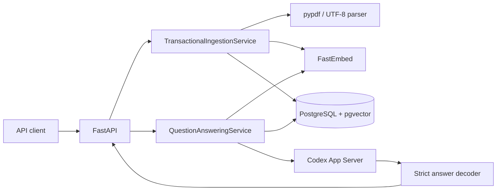

# Architecture

> **독자와 목적:** 평가자·유지보수자가 upload부터 cache write까지의 경계와 실패 시
> 보존해야 할 불변식을 이해하기 위한 문서입니다. 실행은
> [Evaluator Manual](./docs/EVALUATOR_MANUAL.md), 현재 판정은
> [V2 Traceability](./docs/V2_REQUIREMENTS_TRACEABILITY.md)를 사용하십시오. V1의
> 역사적 runtime 증거는 V2 완료 증거로 재사용하지 않습니다.

## 1. Why–What–How

### Why

V1의 SQLite metadata/cache와 Chroma vector mutation은 하나의 transaction으로
묶이지 않아 document version, chunk, cache invalidation이 부분 반영될 수
있습니다. V2는 재현 가능한 실패 경계와 stale-cache 방지를 우선합니다.

### What

- FastAPI HTTP/SSE adapter
- parser와 page-safe 문자·proxy-token 이중 상한 chunk preparation
- FastEmbed 384차원 embedding
- PostgreSQL 17.10 + pgvector 0.8.6 단일 CorpusStore
- Codex App Server incremental LLM gateway
- 완성 prompt를 세는 tiktoken `o200k_base` proxy와 evidence packing
- prompt/embedding/retrieval version이 결합된 answer cache
- exact-SHA lock·host·Docker·readiness를 검증하는 GitHub `quality-gates`
- 입력 원문을 기록하지 않는 request-scoped structured timing receipt
- hash·승인 상태와 split 격리를 가진 합성 gold evaluator
- 같은 Docker backend의 수동 async streaming standby·promotion drill

### How



`api → application → domain port ← infrastructure` 방향을 유지하고
`bootstrap.py`가 migration, CorpusStore, embedding과 Codex gateway를 조립합니다.

## 2. 수집 transaction

1. `/v1/documents`가 upload limit과 파일명을 검증합니다.
2. 실제 PDF/TXT/MD parser가 page/offset을 보존해 text를 추출합니다.
3. 청킹과 embedding은 DB transaction 밖에서 끝냅니다. 청크는 page를 넘지
   않고 기본 900 Unicode code point·900 `o200k_base` proxy token 이하이며
   150 code point를 overlap합니다. tokenizer 실패는 embedding·DB commit 전에 sanitized
   `502`로 fail-closed합니다.
4. normalized filename advisory lock을 얻고 현재 hash/version을 다시 읽습니다.
5. document row, chunk text/vector, cache invalidation, ready 전환과 corpus revision을
   한 PostgreSQL transaction에서 변경합니다.
6. same-byte ready document는 저장된 chunking·indexing policy까지 현재 policy와
   같을 때만 version/revision/cache의 no-op입니다. chunking policy가 다르면
   재청킹하고, embedding을 포함한 indexing policy가 다르면 재색인합니다. 두 경우
   모두 새 version을 만들고 active answer cache 전체를 무효화합니다.

다음 중 하나라도 실패하면 모두 rollback되고 이전 ready version과 active cache가
유지됩니다.

- 새 document/version과 `chunking_version`·`indexing_version`
- `document_chunks.embedding vector(384)`
- dependency 또는 새 evidence similarity 기반 cache invalidation
- 이전/new ready 상태
- `corpus_state.revision`

동일 document는 advisory lock으로 직렬화합니다. 서로 다른 document는 병렬
prepare를 허용하고 singleton revision row update가 증가를 직렬화합니다.

## 3. 검색·생성·cache race

1. 질문을 NFKC/casefold/공백 축소로 정규화하고 query embedding을 만듭니다.
2. active cache에서 exact를 먼저, 이후 cosine `>= 0.95` similar row를 찾습니다.
3. cache hit는 `prompt_version`, `embedding_version`, `retrieval_version`이 현재
   설정과 모두 일치할 때만 허용합니다. 불일치 active row는 soft invalidation합니다.
4. cache miss는 corpus revision을 읽은 같은 DB snapshot에서 pgvector exact cosine
   top-k를 조회합니다. score는 `1 - cosine_distance`입니다.
5. 기본 `0.30` 미만이면 LLM을 호출하거나 cache하지 않고 no-evidence를 반환합니다.
6. 관련 청크가 있으면 완성 JSON prompt를 tiktoken `o200k_base` proxy로 셉니다. 기본
   `4096`을 넘으면 retrieval 순서대로 통째로 들어가는 청크만 선택합니다.
7. 한 청크도 들어가지 않으면 `prompt_budget` 경로로 LLM·citation·cache write를
   건너뜁니다. 들어가면 선택된 청크만 Codex prompt와 citation에 사용하고, 일부
   후보를 제외한 답변은 `prompt_evidence_reduced`로 cache하지 않습니다.
8. LLM 호출과 SSE 동안 DB transaction/lock을 보유하지 않습니다.
9. 완료 뒤 retrieval 당시 revision이 여전히 현재 revision일 때만 answer cache와
   citation dependency를 저장합니다. 다르면 `cache_skip_reason=corpus_changed`입니다.
   모든 relevant hit가 prompt에 들어간 답변만 이 단계에 도달합니다.

`CREATED`는 모든 active cache를, `UPDATED`는 기존 dependency와 새 chunk에
관련성이 생긴 cache의 합집합을 무효화합니다. chunking policy가 달라진
`UPDATED`는 이전 citation·retrieval 의미를 재사용하지 않도록 active cache 전체를
무효화합니다. prompt/embedding/retrieval 구성 불일치가 있어도 관련성 비교를
신뢰하지 않고 전체 fallback invalidation합니다.

Chunking policy ID는 algorithm version, 문자·proxy-token 상한, 문자 overlap과
tokenizer package/encoding/policy identity를 SHA-256으로 digest합니다. retrieval
version은 이 policy ID의 digest를 다시 포함해 청크 경계가 다른 answer
cache가 섞이지 않게 합니다. raw tokenizer identity는 DB 및 retrieval
version에 노출하지 않습니다.

## 4. Prompt와 citation 의미

`PROMPT_TEMPLATE_VERSION`은
`src/officeagent/application/prompts.py`의 단일 정본입니다. prompt에는 한 번만
나오는 `UNTRUSTED_INPUT_JSON:` marker 뒤에 다음 데이터를 JSON으로 넣습니다.

```json
{
  "prompt_version": "grounded-structured-answer-v4:counter=<16-hex>:budget=4096",
  "question": "사용자 질문",
  "evidence": [
    {
      "id": 1,
      "text": "검색 청크 원문",
      "metadata": {
        "document_id": "...",
        "document_version": 1,
        "filename": "...",
        "chunk_id": "...",
        "chunk_index": 0,
        "page_number": null,
        "start_offset": 0,
        "end_offset": 42,
        "score": 0.91
      }
    }
  ]
}
```

JSON은 deterministic serialization 후 `<`, `>`, `&`를 Unicode escape합니다.
이는 question/evidence/metadata의 delimiter breakout을 막는 구조적 경계이며
prompt injection의 의미적 완전 차단이나 answer entailment 증거는 아닙니다.

citation은 score gate와 prompt proxy budget을 모두 통과한 `Chunk`에서 서버가 만든
retrieval provenance입니다. 모델이 모든 청크를 실제 사용했는지 확인하는
post-generation verifier는 없습니다.

이 budget은 tiktoken `o200k_base`가 완성 application prompt를 자르지 않고 센
proxy입니다. Codex tokenizer, App Server의 추가 context, output reserve나 실제 model
context limit을 측정하지 않습니다. template, tokenizer package/encoding/policy 또는
budget 변화는 effective `prompt_version`을 바꾸므로 이전 cache와 섞이지 않습니다.

Codex turn에는 `{"answer": string}` 한 필드 output schema를 적용합니다. 모델의
structured delta는 전용 decoder가 JSON 문자열 escape와 Unicode surrogate를
incremental하게 해석하고, client에는 answer text만 전달합니다. citation은 계속
모델 출력과 분리합니다.

## 5. Codex와 SSE

`CodexAppServerGateway`는 host의 `codex app-server --listen stdio://`를 사용합니다.
ephemeral/read-only/never-approve/no-tool thread를 만들고 같은 turn과 같은
agent-message item의 `item/agentMessage/delta`만 받습니다. JSON 문법은 전달하지
않고 decoder가 해석한 provisional answer 문자열 조각만 `answer.delta`로 보냅니다.
client는 `answer.completed` 전까지 이를 성공 답변으로 확정하면 안 됩니다.

Codex child에는 `PATH`·`HOME`·`CODEX_HOME`, locale/temp/certificate/proxy 등 실행에
필요한 allowlist만 전달합니다. API key, database URL, Git/cloud token을 비롯한 그
밖의 host 환경 변수는 상속하지 않습니다. 전용 cwd와 read-only sandbox는 OS 수준
read privacy boundary라는 주장이 아니며, live smoke는 repository 밖의 일회용 cwd를
사용합니다.

live smoke의 DB 경계는 제품 DB와 분리됩니다. admin conninfo는 loopback host의
`postgres` database만 허용하고, 무작위 `officeagent_test_<12hex>` database를
생성합니다. `build_services` startup으로 migration을 적용한 후 그 database로만
HTTP flow를 수행하며 정상·예외 모두에서 삭제합니다. loopback HTTP client는
proxy 환경을 상속하지 않습니다.

gateway가 application에 첫 non-empty decoded fragment를 yield하기 전
transport/timeout만 한 번 재시도하고, answer 이전 JSON framing만 받은 상태는 아직
visible하지 않은 것으로 봅니다. 공백을 포함해 한 글자라도 yield한 뒤에는
중복 답변과 이중 사용량을 피하기 위해 재시도하지 않습니다. protocol 위반은
재시도하지 않으며 성공 completion·citation·cache write에 도달하지 않습니다.
이미 보낸 SSE 일부는 회수할 수 없고 마지막 `answer.error`가 실패를 표시합니다.
이 cutoff는 client socket 수신 여부나 exactly-once 전달을 보장하지 않습니다.
cache hit의 80자 replay는
`cache_hit=true`로 live delta와 구분합니다. live smoke harness는 citation 및
`miss → exact hit → 문서 update → miss`를 한 runtime에서 검증하고, 두 miss에
복수의 실제 delta를 요구합니다. receipt는 정규화된 Codex CLI version과
sanitized citation metadata만 남기고 답변·cwd·DB conninfo를 제외합니다.

이 경로의 과거 V1 smoke는 V2 증거로 재사용하지 않았습니다. current V2 SHA에서
실제 Codex App Server와 Uvicorn HTTP/SSE를 별도 실행해 incremental delta,
citation과 cache 전이를 확인했습니다.

## 6. 데이터 소유권

| Table | 책임 |
|---|---|
| `documents` | stable ID/key, MIME/hash/version, chunking/indexing policy, ready, timestamps |
| `document_chunks` | versioned text, page/offset provenance, `vector(384)` |
| `corpus_state` | retrieval→LLM→cache-write race guard revision |
| `answer_cache` | question vector, answer/citations, 세 config version, active/invalidation |
| `cache_dependencies` | cache와 cited document/version 관계 |
| `schema_migrations` | forward-only version/checksum/applied time |

Migration runner는 session advisory lock, checksum과 applied-prefix 검사를
fail-closed로 적용합니다. 각 migration은 독립 transaction입니다. 공식 test
runner는 suite마다 고유 temporary database 하나를 생성·삭제하고, 별도 격리가
필요한 migration test는 test별 disposable database를 사용합니다.

Forward-only `0002` migration은 기존 document row에
`legacy-page-safe-character-v1:unknown-settings` sentinel을 적용하고 기존 chunk·
dependency를 보존합니다. migration 자체는 원문이나 예전 설정을 추측해
재청킹하지 않으며, 현재 policy로의 이관은 각 파일의 same-filename
재업로드에서만 일어납니다.

Forward-only `0003`은 같은 방식으로
`legacy-document-index-v1:unknown-settings`를 적용합니다. 새 write의 indexing ID는
domain policy 함수가 chunking ID와 cache의 embedding version에서 단일하게 계산하므로
caller가 서로 모순된 두 값을 전달할 수 없습니다. content hash와 두 policy ID가 모두 같을
때만 same-file upload가 no-op이고, embedding을 포함한 indexing policy만 바뀌어도
새 vector version을 저장하고 active cache를 전체 무효화합니다. digest는 원 identity
문자열을 DB에 복제하지 않기 위한 식별자이며 비밀화 보장은 아닙니다.

## 7. Docker·credential 경계

Docker는 PostgreSQL/pgvector, migration과 구독 없는 integration test를
소유합니다. API와 실제 Codex는 host에 남깁니다.

Test image build와 runtime test는 다음을 거부합니다.

- Node와 Codex executable
- `OPENAI_*`, `CODEX_*`, `*_API_KEY`, `*_TOKEN`
- `/root/.codex`, `/app/.codex`와 `.codex` mount
- `officeagent_test_<hex>`가 아닌 effective libpq database target

이 경계 덕분에 offline suite에서 LLM과 embedding만 double이고 PostgreSQL,
migration, pgvector, parser와 cache transaction은 실제 구현입니다. HTTP/SSE는
in-process FastAPI ASGI 계약이며 TCP/Uvicorn 또는 실제 Codex streaming 증거가
아닙니다.

Hosted `quality-gates`는 최소 `contents: read` 권한으로 candidate head SHA를 직접
checkout한 뒤 lock, Ruff, host suite, Compose config/build, migration, Docker suite,
DB-backed `/health/ready`와 evaluator 문서 검사를 실행합니다. checkout credential은
보존하지 않습니다. 사용자 등록 repository secret, Codex, 배포, image publish와
artifact upload step은 없지만 checkout·action·dependency download에는 최소 권한의
자동 `GITHUB_TOKEN`과 외부 package registry를 사용합니다. CI 성공은 Codex-free
회귀 증거이며 실제 Codex/SSE 증거를 대신하지 않습니다.

### Disposable recovery drill 경계

`compose.recovery-drill.yaml`은 기본 제품 Compose와 분리된 opt-in topology입니다.
논리 경로는 custom `pg_dump`를 별도 database에 `pg_restore`하고, physical 경로만
`pg_basebackup`과 archived WAL의 `recovery_target_time` replay로 PITR라 부릅니다.
`pg_verifybackup` 뒤 실제 recovery server에서 target 전·후 marker와 promotion을
검사하므로 manifest 검사만으로 복구 성공을 주장하지 않습니다.
스키마는 SQL 파일을 직접 실행하지 않고 제품 `officeagent-migrate`로 적용합니다.
소스의 발견된 migration manifest와 primary, logical restore, recovered server의
`schema_migrations` head·checksum을 일치시키고 `documents.chunking_version`까지
존재해야 receipt를 만듭니다.

runner는 비어 있지 않은 `DOCKER_HOST`를 거부하고 선택된 local Unix-socket context만
허용합니다. repository-owned Compose는 host port 없이 internal network와 random
project volume을 사용하며 제품 DB·Codex 환경을 전달하지 않습니다. cleanup 성공
뒤에만 receipt를 출력합니다. 같은 Docker backend와 local volume store를 사용하는
합성 drill이므로 host/daemon/storage 장애, backup schedule·retention·off-host copy,
encryption·monitoring, production RPO/RTO 또는 HA를 증명하지 않습니다. 세부 실행과
수동 잔여물 정리는 [Evaluator Manual](./docs/EVALUATOR_MANUAL.md#33-일회용-postgresql-복구-drill)이 소유합니다.

### Disposable async standby drill 경계

`compose.ha-local.yaml`은 제품 Compose와 recovery drill에서 분리된 opt-in topology입니다.
runner는 physical base backup으로 standby를 만들고 `pg_stat_replication`의
`streaming|async`, marker 존재와 replay LSN을 확인합니다. old primary를 명시적으로
stop한 뒤 direct standby read를 확인하고, 같은 multi-host route의
`target_session_attrs=read-write` 접속이 실패해야 다음 단계로 갑니다. 이 실패만으로
판정하지 않고 즉시 같은 route를 `any`로 실행해 recovering standby에 연결되는지를
추가 증거로 요구하므로 DNS·인증·startup 실패를 read-write 거절로 오인할 위험을
줄입니다. `any` 자체는 read-only를 요구하지 않으며 `pg_is_in_recovery()` 결과가
선택된 node의 상태를 증명합니다.

promotion은 자동 election이 아니라 `pg_promote(true, 60)`을 직접 호출합니다. 이후
같은 read-write route가 promoted standby를 선택해 marker를 한 번 쓰고, old primary가
계속 stopped인지 재확인합니다. replication passfile은 standby container 시작 때
`0600`으로 runtime tmpfs에 만들며 named PGDATA volume에는 남기지 않습니다. random
project, internal network, host port 없음, child environment allowlist를 사용합니다.
teardown 명령 성공만 신뢰하지 않고 project container·volume·network와 전용 migration
image가 각각 없는지 재조회한 뒤에만 receipt를 만듭니다.

이 drill은 한 Docker daemon과 storage/network failure domain 안의 수동 절차입니다.
automatic failover, quorum, split-brain 방지용 production fencing, cross-host 장애,
zero-loss, RPO/RTO, 운영 monitoring이나 제품 traffic 전환을 구현하거나 증명하지
않습니다. 실행과 비정상 종료 cleanup은
[Evaluator Manual](./docs/EVALUATOR_MANUAL.md#34-일회용-postgresql-비동기-standby-drill)이 소유합니다.

## 8. Readiness 경계

`/health/live`는 process liveness만 반환합니다. V2 완료 계약의 `/health/ready`는
Codex나 embedding model을 호출하지 않고 다음 세 항목만 확인해야 합니다.

- PostgreSQL 연결
- source와 database의 migration head/checksum 일치
- pgvector extension 가용 version

Readiness 실패와 timeout은 credential·DSN·내부 exception을 응답하지 않는
`503`으로 축약합니다. endpoint, DB connect와 query는 기본 5초, 최대 30초인 같은
설정값으로 bound됩니다.
API는 application-owned probe port만 호출하고 Psycopg와 migration 구현을 직접 알지
않습니다. 실행 상태는 V2 Traceability에서 추적합니다.

### Structured timing 경계

API가 만든 UUID request ID를 application service에 전달하고, ingestion은
parse/embed/persist를, question path는 embed/cache lookup/retrieve/LLM/cache write를
측정합니다. 실행되지 않은 stage는 `0`으로 채우지 않고 생략해 cache hit와
no-evidence 경로를 구분합니다. 반복된 같은 stage는 합산합니다. LLM duration은 모든
upstream `anext()` 대기의 합이라 그 호출 내부의 retry 대기도 포함할 수 있지만,
delta를 받은 뒤의 SSE consumer backpressure는 제외합니다. total은 service
pipeline의 wall time이므로 consumer suspension을 포함할 수 있습니다.

receipt schema는 bounded enum, 유한·비음수 duration, API UUID와 sanitized error
type만 허용합니다. application을 직접 호출해 유효하지 않은 request ID를 주입하면
원문 대신 고정 `invalid` sentinel을 기록합니다. question, filename,
document/prompt/answer/citation, DSN과 exception message는 sink에 전달하지 않습니다.
sink 장애는 경고 type만 남기고 제품 결과를 바꾸지 않습니다. 단일 process log이므로
분산 trace, percentile benchmark, SLO와 지속 보관을 증명하지 않습니다.

| schema v1 field | 계약 |
|---|---|
| `event` / `schema_version` | 고정 `officeagent.pipeline_timing` / `1` |
| `request_id` | API UUID v4; 잘못된 직접 주입은 고정 `invalid` |
| `operation` | `document_ingestion` 또는 `question_answering` |
| `outcome` | `completed`, `error`, `cancelled` |
| `stages_ms` | 허용 stage 중 실행된 항목만, 소수점 3자리 ms |
| `total_ms` | 유한·비음수이며 각 개별 stage 이상 |
| `cache_hit` / `cache_match` | `true`일 때만 `exact` 또는 `similar`; 아니면 null |
| `answer_path` | `cache_hit`, `grounded`, `no_evidence`, `prompt_budget` 또는 null |
| `error_type` | message 없는 type name을 허용 문자로 치환하고 80자로 제한; 없으면 생략 |

`PipelineTimer.finish()`는 terminal receipt를 process 안에서 한 번 구성합니다. 기본
sink 전달은 best-effort라 delivery exact-once를 보장하지 않습니다. QA 성공은
`answer.completed`를 yield하기 전에 receipt를 구성하고, service에 도달한 exception은
`error`, `GeneratorExit`와 `asyncio.CancelledError`는 `cancelled`로 분류합니다. route
body validation 또는 upload `file.read()`처럼 application service 진입 전에 실패한
작업은 이 receipt 범위 밖입니다.

### Quality evaluation 경계

`evals/gold/v1` manifest는 case JSONL과 split별 합성 문서 bytes를 SHA-256으로
고정하고, dataset-relative path를 사용한 portable dataset hash를 계산합니다.
`approval.json`은 그 hash에 사용자 채택을 결합하지만 현재는 `pending`입니다. 공개된
holdout은 개발 중 직접 보지 않는 process 분리일 뿐 blind benchmark가 아닙니다.

실제 runner는 선택한 split의 문서만 제품 ingestion에 넣고 같은 product question
service를 호출합니다. loopback `postgres` admin에서
`officeagent_eval_<split>_<12hex>` database만 생성하고 migration 뒤 네 product
table과 corpus revision이 비었는지 확인하며 finally에서 DB를 삭제합니다. remote
host, product DB 이름, 다른 split 이름과 libpq service target은 실행 전에 거부합니다.

retrieval hit·MRR은 server citation 순위를, answer/citation claim coverage는 사람이
적은 alias의 Unicode-normalized 포함 여부를, abstention은 표준 no-evidence text,
`grounded=false`와 빈 citation을 함께 검사합니다. 이 결정론적 lexical oracle은
semantic entailment·NLI·factuality가 아니며, 실제 FastEmbed/PostgreSQL/Codex run은
아직 실행 증거가 없습니다.

## 9. 검증과 상태

공식 offline suite와 hosted `quality-gates`의 불변 경계는 실제
PostgreSQL/pgvector, parser, transaction과 in-process FastAPI ASGI 계약이며 LLM과
embedding만 double로 교체합니다. 이 경계는 실제 Codex incremental SSE를 증명하지
않습니다. 변동 영수증과 승격 여부는
[V2 Traceability](./docs/V2_REQUIREMENTS_TRACEABILITY.md)만 갱신합니다.

## 10. Trade-off와 한계

- PostgreSQL/pgvector는 한 transaction과 운영 진실원천을 제공하지만 Docker,
  migration, backup/restore 운영비가 생깁니다.
- exact vector scan은 이번 corpus에 단순하고 결정론적이지만 대규모 latency를
  보장하지 않습니다.
- chunker의 `o200k_base` 상한은 바이트·토큰 밀도가 높은 입력을 제한하는
  proxy입니다. semantic 경계, 정확한 Codex tokenizer, 품질 향상을 보장하지
  않으며 상한·overlap은 Python Unicode code-point 단위입니다. grapheme
  cluster 경계를 보존하지 않습니다.
- 제품은 단일 노드이며 automatic failover와 production HA/recovery control plane,
  OCR, document delete, tenant isolation은 비범위입니다. 별도 local recovery와
  수동 async standby drill은 운영 절차의 일부 경계만 검증합니다.
- 동일 질문 cache miss single-flight가 없어 Codex 중복 호출 가능성이 있습니다.
- 구조화 decoder는 answer 65,536자, raw JSON 1,048,576자, stdio line 8 MiB의
  로컬 상한을 둡니다. prompt proxy budget은 실제 Codex headroom을 보장하지 않고
  answer 의미 검증도 제공하지 않습니다.
- threshold `0.30`/`0.95`는 초기값이며 gold-set 최적값이라고 주장하지 않습니다.
- gold v1은 사용자 채택 전 합성 candidate이며 공개 holdout과 lexical proxy의 한계를
  가집니다.
- enterprise support 또는 pgvector vendor SLA는 이 구현만으로 증명되지 않습니다.

배운 점: Docker 자체보다 transaction·rollback·동시성·credential 격리를 실행
증거로 만드는 것이 유지보수 경제성과 채용 과제 합격 가능성에 더 직접적입니다.
