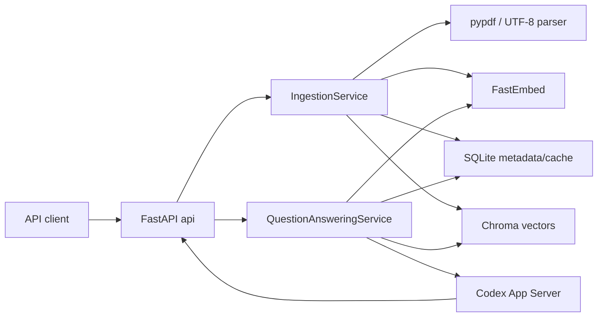

# Architecture

## 1. 목표와 경계

핵심 목표는 “업로드된 문서에 근거한 답변”을 재현 가능하게 만드는 것입니다.
FastAPI는 주로 전송을 담당하고, 수집·검색·캐시·생성 규칙은 application 계층에
둡니다. 저장소·embedding·Codex 프로토콜은 domain port 뒤의 infrastructure
adapter입니다.



주요 상태 저장·검색·생성 의존은
`api → application → domain port ← infrastructure` 방향이며, `bootstrap.py`가
그 concrete adapter를 조립합니다. 다만 현재 구현은 strict hexagonal 구조가
아닙니다. `IngestionService`가 parser 함수를 infrastructure에서 직접 import하고,
FastAPI adapter도 parser validation exception을 직접 import하는 실용적 예외가
있습니다.

## 2. 폴더 책임

```text
src/officeagent/
├── api/                 # FastAPI route, Pydantic schema, SSE 직렬화
├── application/         # ingestion/query use case, prompt, chunking
├── domain/              # framework-independent model과 Protocol
├── infrastructure/      # parser, FastEmbed, SQLite, Chroma, Codex
├── bootstrap.py         # production composition root
└── main.py              # uvicorn entrypoint
tests/                   # unit, adapter, end-to-end use-case tests
docs/adr/                # 되돌리기 어려운 결정의 Why–What–How
retros/                  # Retrobot이 관리하는 AI 협업 회고
```

네이밍 계약은 [ADR-0001](./docs/adr/ADR-0001-repository-structure-and-naming.md)에
고정했습니다.
현재 기술 선택의 정본은 [Technology Decision Register](./docs/DECISION_LOG.md),
되돌리기 어렵거나 위험한 결정의 상세 근거는 연결된 ADR입니다.

## 3. 수집 흐름

1. `/v1/documents`가 multipart 파일을 읽고 20 MiB 상한을 확인합니다.
2. 클라이언트 경로를 제거한 파일명과 확장자로 PDF/TXT/MD parser를 선택합니다.
3. 원본 byte의 SHA-256으로 변경 여부를 판단합니다.
4. SQLite는 파일명 기반 UUID를 유지하고 실제 내용 변경 때만 version을 올립니다.
5. metadata upsert 직후, failure-prone embedding/vector 작업 전에 cache를
   무효화합니다. `CREATED`와 `UNCHANGED`는 corpus 전체를, `UPDATED`는 해당
   문서를 인용한 dependency만 무효화합니다.
6. page를 넘지 않는 900자 청크(150자 overlap)를 만듭니다. 가능한 경우 60%
   이후 공백에서 경계를 자릅니다.
7. FastEmbed `passage_embed`로 384차원 벡터를 만들고 Chroma의 해당 문서 청크를
   교체합니다.

TXT/MD 출처는 문자 `start_offset`/`end_offset`, PDF는 1-based `page_number`와
offset을 함께 저장합니다. 같은 byte를 재업로드해도 version은 올라가지 않지만
corpus 전체 cache를 무효화하고 벡터를 다시 씁니다. 현재 metadata schema에는
정상적인 same-hash 재업로드와, metadata만 반영된 뒤 embedding/vector가 실패한
재시도를 구분하는 readiness 상태가 없기 때문입니다.

SQLite와 Chroma 사이에는 분산 트랜잭션이 없습니다. SQLite metadata가 먼저
commit되며 cache 무효화도 embedding/vector보다 먼저 수행됩니다. 이후 작업이
실패하면 오류를 그대로 전파하지만, 그 사이 질의는 Chroma에 남은 이전 또는
부분 corpus로 답하고 다시 cache할 수 있습니다. 같은 byte의 재시도는
`UNCHANGED`로 분류되어 corpus 전체 cache를 다시 무효화한 다음 re-index하므로,
첫 실패와 재시도 사이에 순차적으로 만들어진 cache도 제거합니다.

이 보상 경계는 cross-store 원자성이나 절대적인 stale-answer 방지를 주장하지
않습니다. 정상 same-hash 재업로드도 관련 없는 cache까지 제거하는 비용이 있고,
무효화와 vector 교체 사이의 동시 질의가 다시 cache를 만드는 race는 남습니다.
또한 Chroma 교체는 delete와 upsert가 하나의 트랜잭션이 아니어서 중간 실패 시
이전, 부분 또는 빈 vector 상태가 관찰될 수 있습니다.

## 4. 질의와 답변 흐름

1. 질문을 NFKC, casefold, 연속 공백 축소로 정규화하고 `query_embed`합니다.
2. SQLite에서 유효한 exact 질문을 먼저, 없으면 cosine `>= 0.95`인 가장 유사한
   질문을 찾습니다.
3. cache miss면 Chroma cosine 검색 상위 5개(기본값, 설정 가능 상한 20)를
   가져와 score `>= 0.30`만 근거로 인정합니다. 노출 score는
   `1 - cosine_distance`입니다.
4. 근거가 없으면 Codex를 호출하지 않고 명시적으로 답변 불가를 반환합니다.
5. 근거가 있으면 문서 청크를 untrusted evidence로 감싼 prompt를 Codex에 보냅니다.
6. App Server의 실제 `item/agentMessage/delta`를 즉시
   `answer.delta` SSE로 전달합니다.
7. 출처는 LLM 문자열을 믿지 않고 score gate를 통과한 검색 `Chunk`에서 서버가
   결정론적으로 생성합니다.
8. 완성 answer와 검색 citation의 document dependency를 SQLite에 저장합니다.

cache hit는 저장된 답변을 80자 단위로 replay하며 `cache_hit=true`와
`cache_match=exact|similar`를 표시합니다. 이는 live model delta로 가장하지
않습니다. 근거 없음 답변은 향후 corpus 변경 영향을 받으므로 캐시하지 않습니다.

현재 citation은 검색 provenance입니다. threshold를 통과한 모든 hit가 citation이
되며, 모델이 각 hit를 실제 답변 근거로 사용했는지 확인하는 post-generation
검증은 없습니다. 따라서 `grounded=true`는 근거 후보가 prompt에 공급되고 turn이
완료됐다는 구현 상태이며, 각 citation의 answer-level entailment를 뜻하지 않습니다.

## 5. Codex App Server 통합

`CodexAppServerGateway`는 요청마다 짧게 `codex app-server --listen stdio://`를
실행합니다.

1. `initialize(clientInfo)` 응답 후 `initialized` notification
2. `thread/start`: 별도 `.data/codex-workspace` cwd, `ephemeral=true`, `sandbox=read-only`,
   `approvalPolicy=never`, `environments=[]`, `dynamicTools=[]`, tool 금지
   base instruction
3. `turn/start`: 질문과 evidence를 하나의 text input으로 전송
4. 같은 thread/turn의 agent-message delta만 전달
5. 같은 turn의 `turn/completed(status=completed)`에서 종료

workspace directory는 실행마다 자동 정리하지 않으므로 영구적인 empty-directory
보장은 아니며 secret을 두지 않아야 합니다. initialize/thread timeout은 각각
10초, 첫 delta는 45초, 전체 turn은 120초입니다.
transport/timeout 실패가 첫 delta 전에 발생했을 때만 새 process로 1회
재시도합니다. 이미 사용자에게 delta를 보낸 뒤에는 중복 답변과 이중 사용량을
막기 위해 재시도하지 않습니다. zero-delta 완료와 failed turn은 오류입니다.

실제 0.145 런타임 스모크에서 `environments=[]`가 experimental capability를
요구함을 발견했습니다. initialize에서 이를 명시적으로 opt-in한 후 빈 environment/
dynamic tool 목록을 보내고, command/MCP/web/file item이 시작되면 turn을 오류로
중단합니다. cache miss 동시 Codex process는 기본 2개, notification queue는
100개로 제한합니다. 전환은
[ADR-0003](./docs/adr/ADR-0003-codex-app-server-streaming.md)에 남겼습니다.

## 6. 데이터 모델

SQLite:

- `documents`: stable id, filename, content type/hash, version, timestamps
- `answer_cache`: 질문, 정규화 질문, embedding JSON, 답변, citation JSON, valid
- `cache_dependencies`: cache id ↔ cited document id

Chroma `document_chunks_v1`:

- id/document: deterministic chunk id와 원문
- embedding: application이 계산한 384차원 vector
- metadata: document id/version, filename, chunk/page/offset

관계형 캐시 검색은 데이터 규모가 작은 과제 환경을 전제로 active embedding을
읽어 cosine을 계산합니다. 대규모 환경에서는 cache embedding도 전용 vector
index로 옮기는 것이 다음 단계입니다.

## 7. 비동기·오류·보안

- PDF extraction, FastEmbed, Chroma의 동기 작업은 `anyio.to_thread`로 event
  loop 밖에서 실행합니다.
- SQLite는 `aiosqlite`, Codex는 asyncio subprocess/stdin/stdout을 사용합니다.
- 지원하지 않는 형식 415, 너무 큰 업로드 413, 비어 있거나 손상된 문서 422,
  비스트리밍 생성 실패 502로 응답합니다.
- SSE 시작 후 오류는 `answer.error` 이벤트로 종료합니다.
- 파일명에서 디렉터리를 제거하고 client-controlled filename/chunk/page metadata는
  prompt attribute용으로 escape합니다. 문서 본문은 untrusted data로 선언합니다.
  이 경계는 prompt injection의 완전 차단이나 의미 안전성 증거는 아닙니다.
  Codex는 별도 `.data/codex-workspace` cwd와
  ephemeral/read-only/never-approve/empty-environment로 제한하며 tool item을
  탐지하면 실패시킵니다.
- API 계층이 모든 SSE 이벤트에 `request_id`를 붙여 로그와 응답을 연결합니다.

## 8. 검증 전략

자동화 테스트는 LLM과 embedding만 deterministic fake로 교체하고 SQLite·Chroma,
parser, HTTP/SSE는 실제 구현을 사용합니다. 따라서 구독 없이 핵심 회귀를
검증하면서도 vector/cache DB 미구현을 mock으로 가리지 않습니다.

별도의 `scripts/live_smoke.py`는 실제 Uvicorn socket에 업로드·질의를 보내
FastEmbed와 Codex App Server의 다중 SSE delta와 citation을 확인합니다. 자동
테스트와 유료·네트워크 경계의 증거를 의도적으로 분리했습니다.

상세 매핑은 [요구사항 추적표](./docs/REQUIREMENTS_TRACEABILITY.md)에 있습니다.

## 9. 현재 한계

- 이미지로만 된 PDF의 OCR은 지원하지 않습니다.
- 로컬 단일 process/단일 node 저장소이며 수평 확장 lock은 없습니다.
- 고정 문자 청킹과 단일 dense retrieval만 구현했습니다.
- 문서 삭제 API와 사용자별 corpus 격리는 과제 범위에 포함하지 않았습니다.
- SQLite metadata/cache와 Chroma vector 교체는 원자적이지 않으며, ingest와
  동시 실행되는 질의의 failure-window recache race는 직렬화하지 않습니다.
- failed-ingest retry의 안전성을 위해 모든 `UNCHANGED` 재업로드에서 corpus
  cache 전체를 무효화하므로 cache 효율보다 보수적입니다.
- 동일 질문의 동시 cache miss를 single-flight로 합치지 않아 Codex 중복 호출과
  경쟁 cache write가 가능하며 ingest/query도 직렬화하지 않습니다.
- citation은 검색 provenance이며 생성 문장에 대한 entailment verifier는 없습니다.

## 10. V2 G2 infrastructure 경계

현재 1~9절은 실제 제품 composition인 V1 SQLite+Chroma를 설명한다. G2는 별도
PostgreSQL 17.10+pgvector 0.8.6 schema, migration runner와 Compose integration
test만 추가했다. `bootstrap.py`, ingestion/query와 API는 아직 이 DB를 사용하지
않으므로 G3 전에는 V2 제품 runtime으로 보지 않는다.

- **Why**: G3 단일 transaction 전 migration·readiness failure를 먼저 격리한다.
- **What**: Psycopg 3, `0001`, digest-pinned DB/test image와 고유 test DB다.
- **How**: checksum/prefix/advisory-lock/rollback과 Docker `33 passed`로 검증했다.
- **Trade-off**: Docker 운영비는 생겼지만 API/Codex credential 경계는 host에
  보존했다.
- **배운 점**: infrastructure 실행과 제품 composition 실행을 별도 gate로 두어야
  Docker 성공을 RAG/SSE 성공으로 과장하지 않는다.
