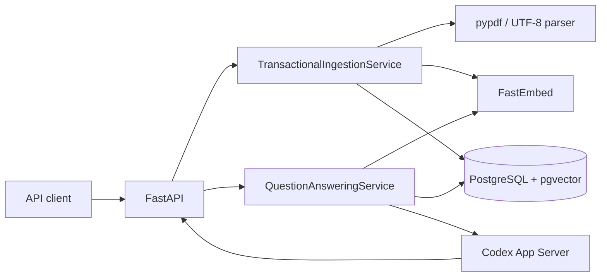

# Architecture

> 상태 경계: 이 문서는 현재 V2 로컬 워크트리의 실제 코드 구조를 설명합니다.
> 구독 없는 Docker suite `48 passed`는 확인했지만 아직 current-SHA, remote parity,
> clean clone과 실제 Codex/SSE 영수증이 없으므로 V2를 `VERIFIED`로 표현하지
> 않습니다. DEC-010~012는 계속 `PROPOSED`입니다.

## 1. Why–What–How

### Why

V1의 SQLite metadata/cache와 Chroma vector mutation은 하나의 transaction으로
묶이지 않아 document version, chunk, cache invalidation이 부분 반영될 수
있습니다. V2는 재현 가능한 실패 경계와 stale-cache 방지를 우선합니다.

### What

- FastAPI HTTP/SSE adapter
- parser와 deterministic chunk preparation
- FastEmbed 384차원 embedding
- PostgreSQL 17.10 + pgvector 0.8.6 단일 CorpusStore
- Codex App Server incremental LLM gateway
- prompt/embedding/retrieval version이 결합된 answer cache

### How



`api → application → domain port ← infrastructure` 방향을 유지하고
`bootstrap.py`가 migration, CorpusStore, embedding과 Codex gateway를 조립합니다.

## 2. 수집 transaction

1. `/v1/documents`가 upload limit과 파일명을 검증합니다.
2. 실제 PDF/TXT/MD parser가 page/offset을 보존해 text를 추출합니다.
3. 청킹과 embedding은 DB transaction 밖에서 끝냅니다.
4. normalized filename advisory lock을 얻고 현재 hash/version을 다시 읽습니다.
5. document row, chunk text/vector, cache invalidation, ready 전환과 corpus revision을
   한 PostgreSQL transaction에서 변경합니다.
6. same-byte ready document는 version/revision/cache의 no-op입니다.

다음 중 하나라도 실패하면 모두 rollback되고 이전 ready version과 active cache가
유지됩니다.

- 새 document/version
- `document_chunks.embedding vector(384)`
- dependency 또는 새 evidence similarity 기반 cache invalidation
- 이전/new ready 상태
- `corpus_state.revision`

동일 document는 advisory lock으로 직렬화합니다. 서로 다른 document는 병렬
prepare를 허용하고 singleton revision row update가 증가를 직렬화합니다.

## 3. 검색·생성·cache race

1. 질문을 NFKC/casefold/공백 축소로 정규화하고 query embedding을 만듭니다.
2. active cache에서 exact를 먼저, 이후 cosine `>= 0.95` similar row를 찾습니다.
3. cache hit는 `prompt_version`, `embedding_version`, `retrieval_version`이 현재
   설정과 모두 일치할 때만 허용합니다. 불일치 active row는 soft invalidation합니다.
4. cache miss는 corpus revision을 읽은 같은 DB snapshot에서 pgvector exact cosine
   top-k를 조회합니다. score는 `1 - cosine_distance`입니다.
5. 기본 `0.30` 미만이면 LLM을 호출하거나 cache하지 않고 no-evidence를 반환합니다.
6. 관련 청크가 있으면 JSON untrusted-data prompt를 Codex에 보냅니다.
7. LLM 호출과 SSE 동안 DB transaction/lock을 보유하지 않습니다.
8. 완료 뒤 retrieval 당시 revision이 여전히 현재 revision일 때만 answer cache와
   citation dependency를 저장합니다. 다르면 `cache_skip_reason=corpus_changed`입니다.

`CREATED`는 모든 active cache를, `UPDATED`는 기존 dependency와 새 chunk에
관련성이 생긴 cache의 합집합을 무효화합니다. prompt/embedding/retrieval 구성
불일치가 있으면 관련성 비교를 신뢰하지 않고 전체 fallback invalidation합니다.

## 4. Prompt와 citation 의미

`PROMPT_TEMPLATE_VERSION`은
`src/officeagent/application/prompts.py`의 단일 정본입니다. prompt에는 한 번만
나오는 `UNTRUSTED_INPUT_JSON:` marker 뒤에 다음 데이터를 JSON으로 넣습니다.

```json
{
  "prompt_version": "grounded-json-v2",
  "question": "사용자 질문",
  "evidence": [
    {
      "text": "검색 청크 원문",
      "metadata": {
        "document_id": "...",
        "document_version": 1,
        "filename": "...",
        "chunk_id": "...",
        "page_number": null,
        "start_offset": 0,
        "end_offset": 42
      }
    }
  ]
}
```

JSON은 deterministic serialization 후 `<`, `>`, `&`를 Unicode escape합니다.
이는 question/evidence/metadata의 delimiter breakout을 막는 구조적 경계이며
prompt injection의 의미적 완전 차단이나 answer entailment 증거는 아닙니다.

citation은 score gate를 통과한 `Chunk`에서 서버가 만든 retrieval provenance입니다.
모델이 모든 청크를 실제 사용했는지 확인하는 post-generation verifier는 없습니다.

structured LLM output은 별도 spike 전까지 구현하지 않습니다. 현재 출력 계약은
plain text delta이며 citation은 모델 출력과 분리합니다.

## 5. Codex와 SSE

`CodexAppServerGateway`는 host의 `codex app-server --listen stdio://`를 사용합니다.
ephemeral/read-only/never-approve/no-tool thread를 만들고 같은 turn의
`item/agentMessage/delta`만 `answer.delta`로 전달합니다.

첫 delta 전 transport/timeout만 한 번 재시도하고 delta 이후에는 중복 답변과
이중 사용량을 피하기 위해 재시도하지 않습니다. cache hit의 80자 replay는
`cache_hit=true`로 live delta와 구분합니다.

이 경로의 과거 V1 smoke는 V2 증거가 아닙니다. current V2 SHA의 실제
Codex/incremental SSE smoke가 별도 gate로 남아 있습니다.

## 6. 데이터 소유권

| Table | 책임 |
|---|---|
| `documents` | stable ID/key, MIME/hash/version, ready, timestamps |
| `document_chunks` | versioned text, page/offset provenance, `vector(384)` |
| `corpus_state` | retrieval→LLM→cache-write race guard revision |
| `answer_cache` | question vector, answer/citations, 세 config version, active/invalidation |
| `cache_dependencies` | cache와 cited document/version 관계 |
| `schema_migrations` | forward-only version/checksum/applied time |

Migration runner는 session advisory lock, checksum과 applied-prefix 검사를
fail-closed로 적용합니다. 각 migration은 독립 transaction이고 테스트마다 고유
database를 생성·삭제합니다.

## 7. Docker·credential 경계

Docker는 PostgreSQL/pgvector, migration과 구독 없는 integration test를
소유합니다. API와 실제 Codex는 host에 남깁니다.

Test image build와 runtime test는 다음을 거부합니다.

- Node와 Codex executable
- `OPENAI_*`, `CODEX_*`, `*_API_KEY`, `*_TOKEN`
- `/root/.codex`, `/app/.codex`와 `.codex` mount

이 경계 덕분에 offline suite에서 LLM과 embedding만 double이고 PostgreSQL,
migration, pgvector, parser, HTTP/SSE와 cache transaction은 실제 구현입니다.

## 8. 검증과 상태

현재 로컬 워크트리:

- `docker compose run --build --rm test` → `48 passed`
- 실제 TXT/PDF HTTP ingestion과 한국어 3문서 retrieval
- exact/similar cache, 세 version mismatch와 update invalidation
- chunk failure와 post-invalidation failure 전체 rollback
- 동일/서로 다른 document concurrency와 revision 일관성
- stale revision cache-write skip
- delimiter breakout JSON round-trip
- test-container credential/runtime isolation

이는 commit에 고정되지 않은 local-worktree 영수증입니다. current-SHA와 remote
parity 전에는 `IMPLEMENTED/PARTIAL`, 실제 Codex/SSE 전에는 제품 end-to-end를
`VERIFIED`로 승격하지 않습니다.

## 9. Trade-off와 한계

- PostgreSQL/pgvector는 한 transaction과 운영 진실원천을 제공하지만 Docker,
  migration, backup/restore 운영비가 생깁니다.
- exact vector scan은 이번 corpus에 단순하고 결정론적이지만 대규모 latency를
  보장하지 않습니다.
- 단일 노드이며 HA/PITR, OCR, document delete, tenant isolation은 비범위입니다.
- 동일 질문 cache miss single-flight가 없어 Codex 중복 호출 가능성이 있습니다.
- threshold `0.30`/`0.95`는 초기값이며 gold-set 최적값이라고 주장하지 않습니다.
- enterprise support 또는 pgvector vendor SLA는 이 구현만으로 증명되지 않습니다.

배운 점: Docker 자체보다 transaction·rollback·동시성·credential 격리를 실행
증거로 만드는 것이 유지보수 경제성과 채용 과제 합격 가능성에 더 직접적입니다.
